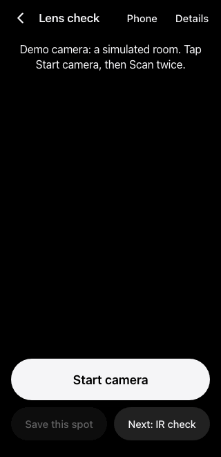
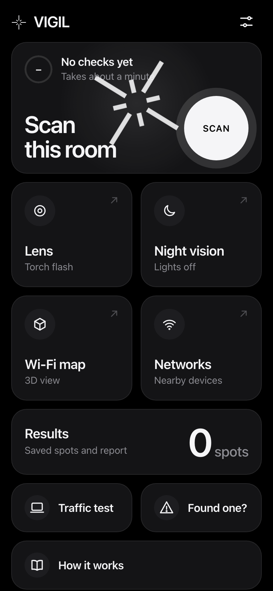
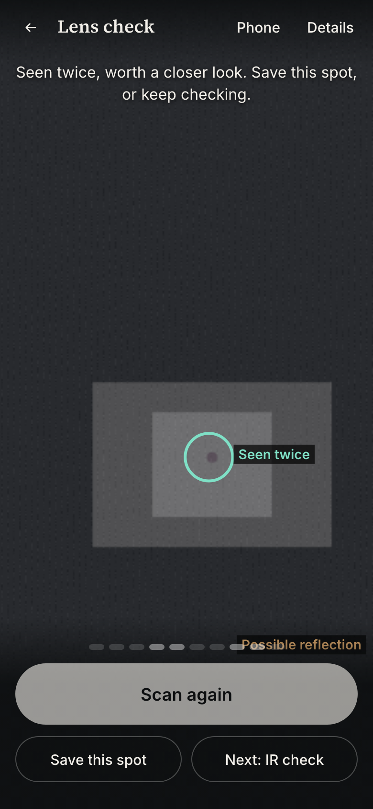
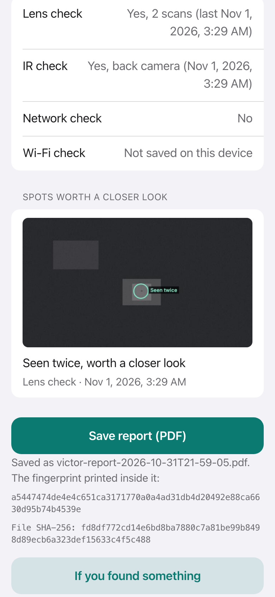
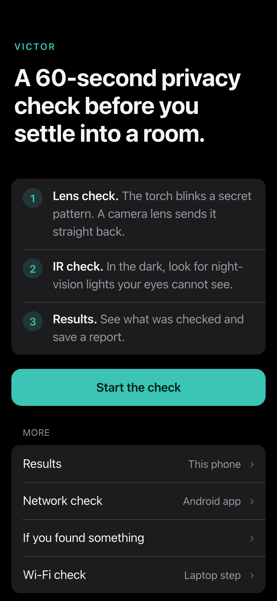

<p align="center"></p>

<h1 align="center">VICTOR</h1>

<p align="center"><b>A 60-second privacy check before you settle into a room.</b><br>
Your phone's torch blinks a secret pattern. A camera lens sends it straight back.</p>

<p align="center">
  <a href="https://arjavnotfound.github.io/victor-hackathon/"><b>Open on your phone</b></a> ·
  <a href="https://github.com/arjavnotfound/victor-hackathon/releases/latest"><b>Download the Android app</b></a> ·
  <a href="docs/how-it-works.md">How it works</a>
</p>

<p align="center">Built by Team VICTOR for the MU20 Opportunity Summit 2026.</p>

<table align="center"><tr>
<td></td>
<td valign="middle">
<b>Try it now</b><br><br>
<br><br>
Scan with an Android phone,<br>then tap <b>Start the check</b>.<br><br>
<sub>The GIF uses the built-in demo camera,<br>not a real room.</sub>
</td>
</tr></table>

---

## Why

Tiny cameras are cheap and easy to hide. They turn up inside phone chargers, bulb holders, smoke detectors and dustbins, in hostels, PGs, rented flats, hotel rooms and washrooms.

| Where | What was found | Source |
|---|---|---|
| Café washroom, Bengaluru (Aug 2024) | Phone recording video, hidden in the dustbin | [The News Minute](https://www.thenewsminute.com/karnataka/bengaluru-coffee-shop-employee-arrested-for-placing-hidden-camera-in-toilet) |
| Rented flat, East Delhi (Sep 2024) | Cameras inside bathroom and bedroom bulb holders | [ThePrint](https://theprint.in/india/delhi-woman-finds-hidden-cameras-in-rented-home-landlords-son-held/2281972) |
| Women's hostel, Ameenpur, Telangana (2025) | Camera inside a mobile charger | [Telangana Today](https://telanganatoday.com/hidden-cameras-fixed-on-mobile-charger-found-jn-womens-hostel-in-ameenpur) |
| PG washroom, Chandigarh | Spy camera in a shared washroom | [The Tribune](https://www.tribuneindia.com/news/chandigarh/spy-camera-in-pg-washroom-girl-male-friend-held-567315) |

Looking by eye misses small lenses. And when someone does suspect a camera, there is rarely a record of what was checked, when, or what was found.

## What it checks

| Check | What it looks for | Where it runs |
|---|---|---|
| **Lens check** | A tiny dot that blinks back in step with the torch's random pattern | Phone (web or app) |
| **IR check** | Night-vision lights your eyes cannot see, in a dark room | Phone (web or app) |
| **Network check** | Wi-Fi names and devices on your Wi-Fi that look like cameras | Android app only |
| **Wi-Fi check** | A device whose traffic rises and falls with a flashing screen | Laptop + Mac Wi-Fi capture |
| **Report** | A PDF of what was checked, with a fingerprint so later changes show | Phone or laptop |

Nothing is uploaded. There is no server and no account.

<table><tr>
<td></td>
<td></td>
<td></td>
<td></td>
</tr></table>

## How it works, in short

**The secret pattern.** Every scan picks a new random on/off pattern. A shiny screw, a lamp or a TV standby light cannot copy a pattern it has never seen. A lens answers without meaning to.

**Lens check.** A lens focuses light onto a flat sensor, and some of it bounces straight back toward the light, like a cat's eyes in headlights. The torch sits next to the phone's camera, so a hidden lens shows up as a small dot that turns on and off with the torch. The app checks every pixel against the pattern and keeps only small dots that follow it. A dot found once is a *possible reflection*. Found again after you move a little, it becomes *seen twice, worth a closer look*.

Before the first scan the app blinks the torch a few times to measure how slow this phone's torch is, and sets the pattern speed to match.

**IR check.** Many cameras have infrared lights for night recording. Phone cameras often see them as white or purple dots. The app looks for small bright dots that stay on or blink steadily.

**Network check (Android app).** Lists nearby Wi-Fi networks and devices on your Wi-Fi, and flags ones that use camera-style names, camera-chip makers, video ports (like 554) or answer camera discovery requests.

**Wi-Fi check (laptop).** A streaming camera sends more data when the picture changes. The laptop screen flashes a random code at the object while a Mac records Wi-Fi packet sizes and times. The device whose traffic follows the code is the camera. The maths is in [docs/how-it-works.md](docs/how-it-works.md).

## Honest limits

- No app finds every camera. An empty result does not prove a room is clear.
- The lens check needs a clear line of sight. A pinhole at a sharp angle or behind dark plastic may not reflect enough.
- Torch control in a web page needs Android Chrome. iPhones do not allow it.
- The network check cannot see cameras on mobile data, on another Wi-Fi, or recording to a memory card. Some Wi-Fi networks hide devices from each other.
- The Wi-Fi check needs a Mac, listens to one channel at a time, and only finds cameras that stream.
- A "worth a closer look" result is a reason to look closely, not proof.

If you do find something, the app has a page on what to do next: [help.html](help.html).

## Run it yourself

```bash
npm install
npm run dev        # https://localhost:5173, phone on the same Wi-Fi: https://<mac-ip>:5173
npm test           # maths and scoring tests
npm run e2e        # clicks through every screen in Chromium, saves docs/screenshots
npm run deploy     # tests, builds and publishes to GitHub Pages
```

Add `?demo=1` to any phone page to use a simulated camera on a laptop.

### Android app

```bash
npm run android:setup   # once: Java and the Android SDK into ~/Android, no Android Studio, no sudo
npm run apk             # builds VICTOR.apk
```

The app is the same web code inside a small Android shell, plus a native plugin for the network check (`android/app/src/main/java/app/teamvictor/check/NetworkCheckPlugin.java`).

### Stack

Vite and plain JavaScript, no framework, no backend. Camera and torch through `getUserMedia`, analysis in a Web Worker, jsPDF for the report, Web Crypto for the fingerprint, Capacitor for the Android app, vitest and Playwright for tests.

## Team VICTOR

- **Arjav Badjatya**, Team Leader
- **Anurag Mahore**
- **Mridini Kudaliya**

MIT License
