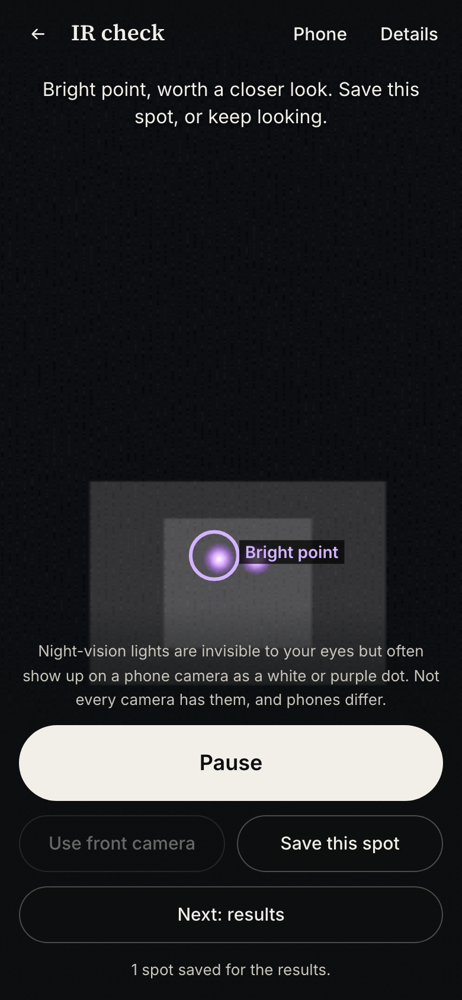
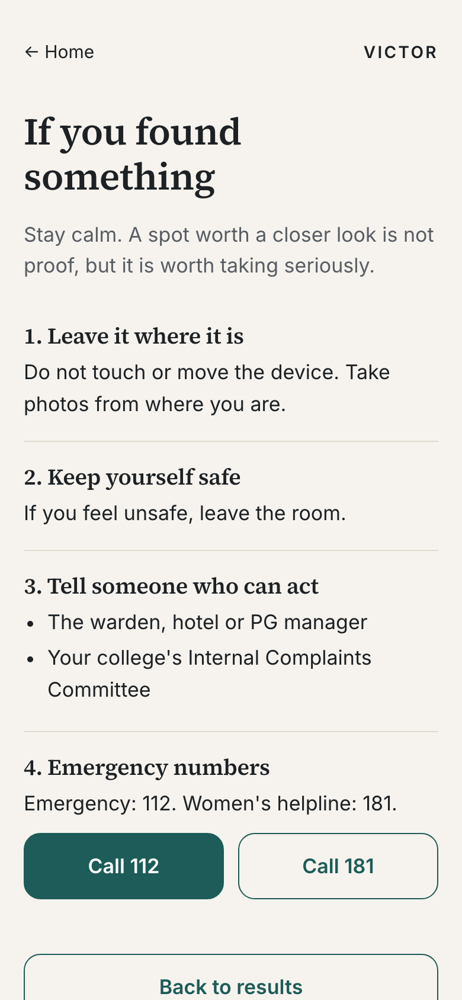
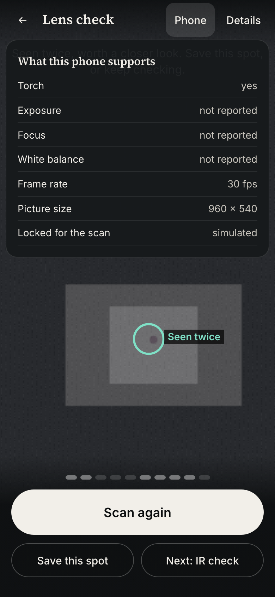
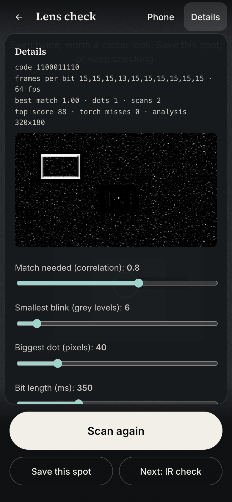
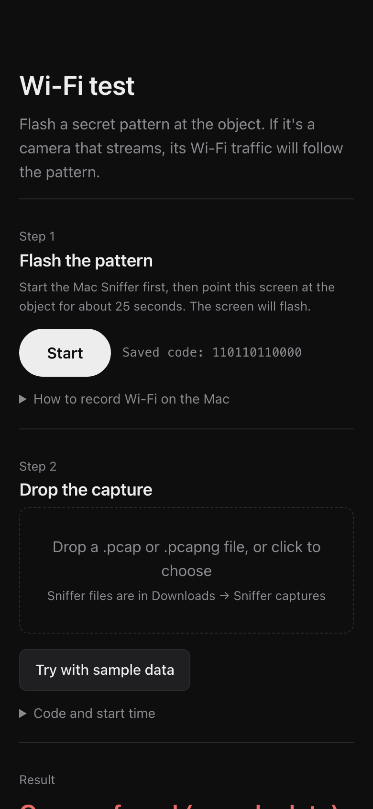
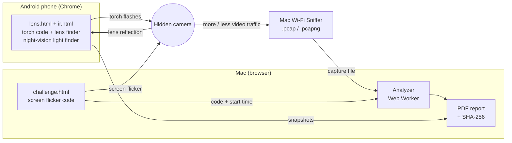
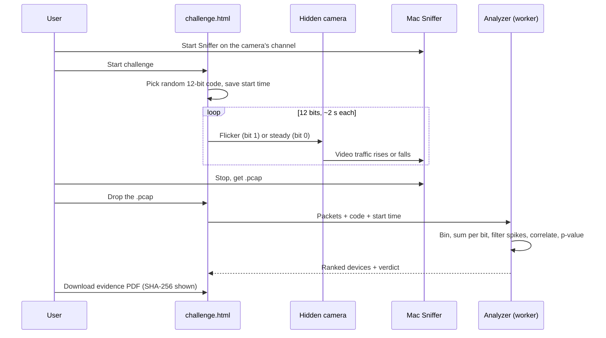

# VICTOR HACKATHON

**Finds hidden cameras by making them react.**
Built by Team VICTOR for the MU20 Opportunity Summit 2026.


<!-- SCREENSHOTS -->
| Home | Lens check | IR check | Results |
|---|---|---|---|
|  |  |  |  |

| If you found something | What this phone supports | Details panel | Wi-Fi check result |
|---|---|---|---|
|  |  |  |  |

Screenshots are from the simulated demo camera in desktop Chromium, not a real room.
<!-- /SCREENSHOTS -->

---

## The problem

Tiny cameras are cheap and easy to hide. They turn up inside phone chargers, bulb holders, smoke detectors, tissue boxes and dustbins, in places where people undress or sleep: hostels, PGs, rented flats, hotel rooms, café washrooms and trial rooms.

- **Looking for them by eye does not work well.** In user tests, people searching a room by eye found the hidden camera only about 46% of the time.
- **Detector apps only scan your own network.** They list devices on the Wi-Fi you are connected to. A camera on the owner's own Wi-Fi, or on mobile data, never shows up.
- **Nobody can prove anything.** When a student says "I think there is a camera", there is no record of what was tested, when, or what was found. It becomes one person's word against another.

### It keeps happening

| Where | What was found | Source |
|---|---|---|
| Café washroom, Bengaluru (Aug 2024) | Phone recording video, hidden in the washroom dustbin | [The News Minute](https://www.thenewsminute.com/karnataka/bengaluru-coffee-shop-employee-arrested-for-placing-hidden-camera-in-toilet) |
| Rented flat, East Delhi (Sep 2024) | Cameras inside the bathroom and bedroom bulb holders | [ThePrint](https://theprint.in/india/delhi-woman-finds-hidden-cameras-in-rented-home-landlords-son-held/2281972) |
| Women's hostel, Ameenpur, Telangana (2025) | Camera inside a mobile charger | [Telangana Today](https://telanganatoday.com/hidden-cameras-fixed-on-mobile-charger-found-jn-womens-hostel-in-ameenpur) |
| PG washroom, Chandigarh | Spy camera in a shared washroom | [The Tribune](https://www.tribuneindia.com/news/chandigarh/spy-camera-in-pg-washroom-girl-male-friend-held-567315) |
| Play school, Noida | Camera in a bulb holder in the teachers' washroom | [Kerala Kaumudi](https://www.keralakaumudi.com/en/news/india/general/installed-hidden-camera-inside-teachers-restroom-school-director-arrested-1445333) |

### The verification gap

In August 2024, students at a college hostel in Gudlavalleru, Andhra Pradesh, protested over hidden cameras they said were in their washroom. Officials then said no camera was found. Two years later, people still argue about what happened. ([The South First](https://thesouthfirst.com/andhrapradesh/claims-of-hidden-cameras-hundreds-of-videos-and-no-complaint-suspicion-mars-andhras-gudlavalleru-college/), [The Week](https://www.theweek.in/news/india/2024/08/30/andhra-cm-chandrababu-naidu-orders-probe-over-alleged-hidden-cameras-in-girl-students-washroom.html))

Whatever the truth was, nobody had a simple way to test the room on the spot and keep a record that others could check. That gap is what VICTOR fills.

---

## How it works

> Every hidden camera has a lens, and if it streams, it has to react to what it sees. We test both.

We never just "look" for a camera. We send a **secret random code** (a pattern of on/off flashes that we pick fresh every time) and check whether something in the room answers back in the same pattern. A reflection, a lamp or a phone on the table cannot guess a code it has never seen. A real camera answers without meaning to.

### Layer 1: the lens (phone torch)
A camera lens with a sensor behind it bounces light straight back toward where it came from (the same effect that makes a cat's eyes glow in a car's headlights). The phone's torch sits right next to its camera, so a hidden lens shows up as a tiny bright dot that switches on and off exactly with the torch.

`lens.html` flashes the torch in a random 10-bit code and checks every pixel to see if it blinks in step with that code. Only small dots that match the code get a circle. A dot seen once is a **Possible reflection**; a dot found again after you move a little is **Seen twice, worth a closer look**.

`ir.html` is the **IR check** for cameras with night-vision lights, which show up as white or purple dots on many phone cameras in the dark. Small bright dots that stay on for about a second, or blink steadily, get a circle. Big lamps and one-frame flashes are ignored.

### Layer 2: Wi-Fi (screen flicker)
A streaming camera compresses its video. When the picture changes a lot, the video needs more data, so the camera sends more Wi-Fi traffic. When the picture is still, it sends less.

`challenge.html` turns the screen into a flashing light that follows a random 12-bit code (about 2 seconds per bit). Point it at the suspicious object. At the same time, a Mac records the Wi-Fi air around it (every device, on any network, encrypted or not; we only need the size and time of each packet). Drop that capture file into the page. The device whose traffic rises and falls with the code is the camera.

### Layer 3: the evidence report
One tap makes a PDF with the time, the secret code, the device's Wi-Fi address and maker, the traffic graph, the snapshots and a SHA-256 fingerprint of the report and the capture file. If anyone changes a single byte later, the fingerprint will not match.

---

## Architecture





---

## The maths (short version)

**Code.** We pick a random code `c` of N bits (N = 10 for the torch, 12 for the screen) and turn it into ±1 values.

**Lens layer, per pixel.**
1. For each bit, average the frames after a short settle time (the camera needs ~120 ms to catch up with the torch).
2. Local contrast: `L = pixel − mean of its 9×9 neighbourhood`. This removes slow light changes across the whole picture and keeps only small bright dots.
3. Correlation with the code, across the N bits:
   `r = Σ (Lᵢ − L̄)(cᵢ − c̄) / sqrt( Σ (Lᵢ − L̄)² · Σ (cᵢ − c̄)² )`
   `r` is between −1 and 1. A lens that blinks with the torch gives `r` close to 1.
4. Keep pixels with high `r` and enough brightness change, group them into blobs, and keep only small blobs (a lens is a dot, a mirror or a wall is not).

**Wi-Fi layer, per device.**
1. Count bytes the device sends in every 100 ms.
2. Clip keyframe spikes: cameras send a big full picture every few seconds no matter what. Any 100 ms bin above `median + 4 × MAD` is cut down to that limit.
3. Add up the bytes inside each 2 s bit to get `s₁ … s₁₂`.
4. Normalised cross-correlation between `s` and the code, trying time offsets in 100 ms steps (clocks and camera delay are never perfect). The score is the best value over all offsets.
5. **p-value:** we repeat step 4 with 200 random codes the camera never saw. `p = (number of random codes that scored as high + 1) / 201`. A small `p` means the match is very unlikely to be luck.

With 12 bits, a random device lines up perfectly by chance about once in 4,096 tries, which is why the code length matters.

---

## Who it is for

- Students in hostels and PGs, and anyone renting a room.
- Women travelling alone and checking a hotel room.
- Hostel wardens, college committees and police who need a quick, recorded test instead of an argument.
- Café, mall and shop owners who want to prove their washrooms and trial rooms are clean.

## Demo flow (5 minutes)

1. **Lens check.** Open the app on the phone, Start the check, point at the object, press Scan. The lens gets a circle; move a little, scan again, it becomes **Seen twice, worth a closer look**. Save the spot.
2. **Wi-Fi challenge.** Start the Mac Sniffer, open `challenge.html`, point the flashing screen at the device, wait ~25 s, stop the Sniffer, drop the file in.
3. **Result.** One device rises to the top with a high score and tiny p-value, its maker shown from its Wi-Fi address. The graph shows its traffic following the code.
4. **Proof.** Download the PDF and show the SHA-256 on screen.
5. **No camera handy?** Press **Run demo replay** for a realistic simulated capture with one camera and several decoys.

## Tech stack

- Vite + plain JavaScript, no framework, no backend.
- Browser APIs: `getUserMedia` + torch / exposure controls, Canvas, Web Worker, Web Crypto (SHA-256).
- jsPDF for the report.
- Own pcap / pcapng parser (radiotap, raw 802.11, Ethernet).
- vitest for tests, Playwright for screenshots.
- Mac capture: Wireless Diagnostics → Sniffer (see [MAC_ENV_REPORT.md](MAC_ENV_REPORT.md)).

## How to run

```bash
npm install
npm run dev
```

Open `https://localhost:5173` on the Mac. On an Android phone on the same Wi-Fi, open `https://<mac-ip>:5173` (find the IP with `ipconfig getifaddr en0`). Accept the certificate warning once (it is a local self-signed certificate).

```bash
npm test          # maths + analyzer tests
npm run e2e       # clicks through every screen in Chromium, saves docs/screenshots
npm run demo-pcap # writes demo/demo.pcap and demo/demo.json
```

The phone flow is: Home → Lens check → IR check → Results (→ If you found something). Add `?demo=1` to any phone page to use a simulated camera on a laptop. The app name lives in `src/config.js`. See [MORNING_TEST.md](MORNING_TEST.md) for the real-phone checklist and [docs/how-it-works.md](docs/how-it-works.md) for a plain explanation.

## Honest limits

- **Torch control needs Android Chrome.** iPhones and most laptops do not let a web page control the torch.
- **The lens test needs line of sight.** A lens behind a dark tinted cover or a pinhole at a very sharp angle may not reflect enough.
- **The Wi-Fi test only works for cameras that stream live.** A camera that records to an SD card and never transmits is invisible to it (the lens layer still works).
- **One channel at a time.** The Mac's Sniffer listens to one Wi-Fi channel. You need to pick the right one (the page tells you which channels are busy).
- **Not live.** The Mac gives a file after you press Stop, so the result comes a minute later.
- **Cameras on mobile data (4G) are not seen** by the Wi-Fi layer.
- A high score is strong evidence, not a court verdict. The report says exactly what was measured.

## Roadmap

- **USB monitor-mode Wi-Fi adapter** so captures run live instead of from a file.
- **Channel hopping** to find the camera's channel automatically.
- **ESP32 listener**: a small, cheap board that sniffs Wi-Fi and sends the results to the phone, so no laptop is needed.
- Support for more phones as browsers add torch control.

## Privacy

- Everything runs in your browser. No server, no account, no upload.
- The capture file never leaves your laptop. We only read packet sizes, times, signal strength and device addresses; we do not (and cannot) read the encrypted content.
- Snapshots and reports are saved only where you save them.

## Team VICTOR

- **Arjav Badjatya** — Team Leader
- **Anurag Mahore**
- **Mridini Kudaliya**

## License

MIT
