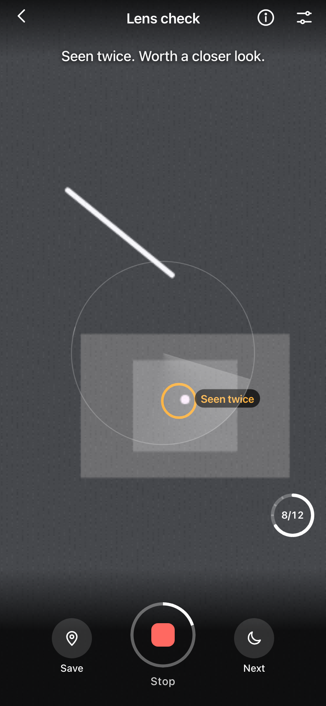
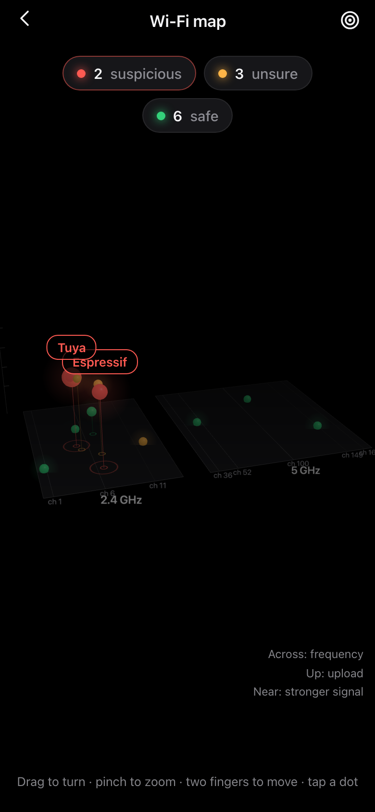
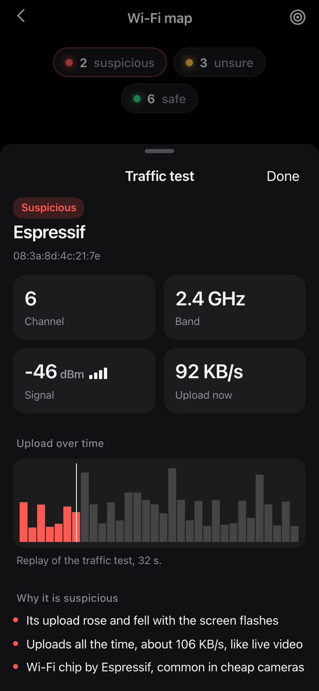
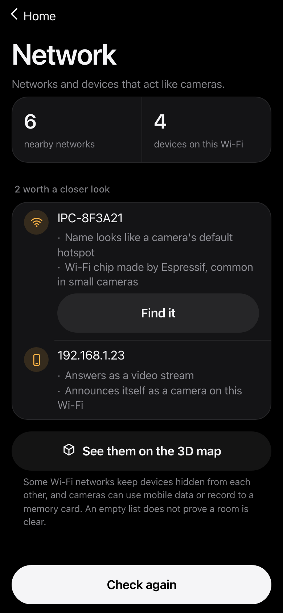

<p align="center"></p>

<h1 align="center">CRCD</h1>

<p align="center"><b>Challenge-Response Camera Detection.</b><br>
We do not look for hidden cameras. We send a secret pattern and see what answers.<br>Five checks, one phone.</p>

<p align="center">
  <a href="https://arjavnotfound.github.io/victor-hackathon/"><b>Open on your phone</b></a> ·
  <a href="https://github.com/arjavnotfound/victor-hackathon/releases/latest"><b>Download the Android app</b></a> ·
  <a href="docs/how-it-works.md">How it works</a>
</p>

<p align="center">Built by Team VICTOR for the MU20 Opportunity Summit 2026.</p>

<table align="center"><tr>
<td></td>
<td valign="middle">
<b>Try it now</b><br><br>
<br><br>
Scan with an Android phone,<br>then tap <b>Scan</b>.<br><br>
<sub>The GIF uses the built-in demo camera,<br>not a real room.</sub>
</td>
</tr></table>

---

## Why

Tiny cameras are cheap and easy to hide. They turn up inside phone chargers, bulb holders, smoke detectors and dustbins, in hostels, PGs, rented flats, hotel rooms and washrooms.

| Where | What was found | Source |
|---|---|---|
| Café washroom, Bengaluru (Aug 2024) | Phone recording video, hidden in the dustbin | [The News Minute](https://www.thenewsminute.com/karnataka/bengaluru-coffee-shop-employee-arrested-for-placing-hidden-camera-in-toilet) |
| Rented flat, East Delhi (Sep 2024) | Cameras inside bathroom and bedroom bulb holders | [ThePrint](https://theprint.in/india/delhi-woman-finds-hidden-cameras-in-rented-home-landlords-son-held/2281972) |
| Women's hostel, Ameenpur, Telangana (2025) | Camera inside a mobile charger | [Telangana Today](https://telanganatoday.com/hidden-cameras-fixed-on-mobile-charger-found-jn-womens-hostel-in-ameenpur) |
| PG washroom, Chandigarh | Spy camera in a shared washroom | [The Tribune](https://www.tribuneindia.com/news/chandigarh/spy-camera-in-pg-washroom-girl-male-friend-held-567315) |

Looking by eye misses small lenses. And when someone does suspect a camera, there is rarely a record of what was checked, when, or what was found.

## The five checks

| Check | What it looks for | Needs |
|---|---|---|
| **Lens** | A tiny dot that blinks back in step with the torch's random pattern | Phone with a torch |
| **Night vision** | Infrared lights your eyes cannot see, in a dark room | Any phone camera |
| **Networks** | Camera hotspot names, camera chip makers, and devices that answer like a video stream | Android app |
| **Traffic test** | A device whose upload rises and falls with a flashing screen | A Wi-Fi recording |
| **3D Wi-Fi map** | Every Wi-Fi source by band, upload and signal, coloured safe, unsure or suspicious | A Wi-Fi recording |

Everything ends in **Results**: one plain answer, photos of each spot, and an evidence PDF with a fingerprint so later edits show. Camera frames never leave the phone. There is no account.

<table><tr>
<td></td>
<td></td>
<td></td>
<td></td>
<td></td>
</tr></table>

## How it works, in short

**The secret pattern.** Every scan picks a new random on/off pattern. A shiny screw, a lamp or a TV standby light cannot copy a pattern it has never seen. A camera answers without meaning to.

**Lens.** A lens focuses light onto a flat sensor, and some of it bounces straight back toward the light, like a cat's eyes in headlights. The torch blinks the pattern; every frame is lined up against hand shake; every pixel is compared with the pattern. Only small, round, isolated dots that follow it are kept. Found once, a dot is a *possible reflection*. Found again after you move, it is *seen twice, worth a closer look*. One tap sweeps until you stop.

**Night vision.** Many cameras have infrared lights for night recording. Phone cameras see them as purple-white dots. The app marks small bright dots that stay on or blink steadily.

**Networks (Android app).** Lists nearby Wi-Fi networks and devices on your Wi-Fi, and flags camera-style names, camera chip makers, video ports (like 554) and devices that answer camera discovery. **Find it** turns signal strength into warmer and colder.

**Traffic test.** A streaming camera sends more data when the picture changes. The screen flashes a random code at the object while the Wi-Fi around it is recorded. The device whose upload follows the code is the camera; 200 random codes are tried too, so a lucky match does not count.

**3D Wi-Fi map.** Every source in the recording becomes a dot: across is band and channel, up is upload, near is stronger signal. Red dots stand out with a ring; tap one for its channel, signal, live upload and the reason for its colour.

The details, with the maths, are in [docs/how-it-works.md](docs/how-it-works.md).

## Honest limits

- No app finds every camera. An empty result does not prove a room is clear.
- The lens check needs a clear line of sight. A pinhole at a sharp angle or behind dark plastic may not reflect enough.
- Torch control in a web page needs Android Chrome. iPhones do not allow it.
- The network check cannot see cameras on mobile data, on another Wi-Fi, or recording to a memory card.
- The traffic test and map need a Wi-Fi recording, listen to one channel at a time, and only see cameras that stream.
- "Worth a closer look" is a reason to look closely, not proof.

If you do find something, the app has a page on what to do next: [help.html](help.html).

## Run it yourself

```bash
npm install
npm run dev        # https://localhost:5173, phone on the same Wi-Fi: https://<mac-ip>:5173
npm run serve      # demo day: builds, serves, and starts the Wi-Fi helper on a Mac
npm test           # maths and scoring tests
npm run e2e        # clicks through every screen in Chromium
npm run deploy     # tests, builds and publishes to GitHub Pages
```

Add `?demo=1` to any page to use a simulated room on a laptop. `npm run listener:demo` simulates the Wi-Fi helper.

### Android app

```bash
npm run android:setup   # once: Java and the Android SDK into ~/Android, no Android Studio, no sudo
npm run apk             # builds CRCD.apk
```

The app is the same web code inside a small Android shell, plus a native plugin for the network check (`android/app/src/main/java/app/teamvictor/check/NetworkCheckPlugin.java`).

### Stack

Vite and plain JavaScript, no framework. Camera and torch through `getUserMedia`, analysis in a Web Worker, three.js for the 3D map, jsPDF for the report, Web Crypto for the fingerprint, Capacitor for the Android app, vitest and Playwright for tests.

## Team VICTOR

- **Arjav Badjatya**, Team Leader
- **Anurag Mahore**
- **Mridini Kudaliya**

MIT License
